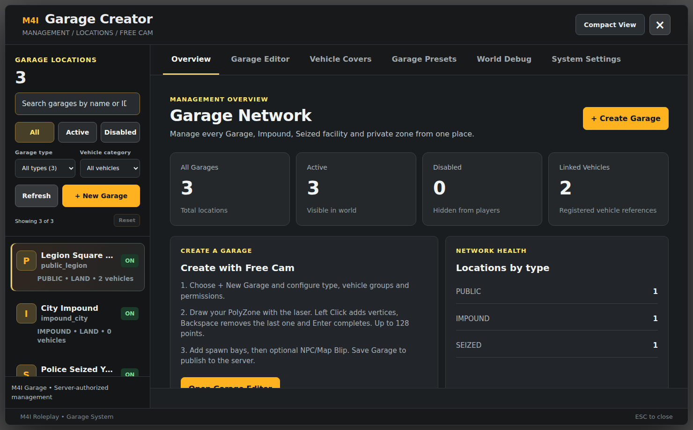

# Complete Installation — M4I Garage

**Official full customer installer:** **[Installation — From Zero to a Working Garage](installation.md)**.

The latest documentation is now organized by Garage feature rather than mixing full manuals of other M4I scripts into this product. Every framework has its own step-by-step guide and independent dependency choices.

## 1. Choose your framework

[M4I Core](frameworks/m4i.md) · [QBCore](frameworks/qbcore.md) · [Qbox / QBX](frameworks/qbox.md) · [ESX Legacy](frameworks/esx.md) · [Ox Core (extra testing required)](frameworks/ox-core.md)

## 2. Complete basic install

Read the [Installation Guide](installation.md) for SQL backup/import, resource files, `server.cfg`, Bridge profile selection, Garage settings, admin ACE, first Creator zone, vehicle registration, Open/Store/Retrieve and final acceptance tests.

## 3. Configure each Garage feature only if you use it

[Player Guide](player-guide.md) · [Creator with Screenshots](visual-setup-guide.md) · [Vehicle Covers](vehicle-cover.md) · [Police & Impound](police-impound.md) · [Insurance, GPS & Transfer](insurance-transfer.md) · [Damage & Repair](damage-persistence.md).

## 4. Required changes in other scripts

See [Garage Integrations](integrations.md) for the precise **external file to edit and the Garage API to call**: dealership, inventory item Use, repair, keys, phone, radial/target and migration. For unrelated settings belonging to those products, use their own Docs.

## 5. Developer API and verification

[Client Exports](client-exports.md) · [Server Exports](server-exports.md) · [Commands](commands.md) · [Updating](updating.md) · [Troubleshooting](troubleshooting.md) · [Go-Live Checklist](verification.md).

**Build:** `m4i_garage 0.1.139-alpha`. Scope here is Garage, not a complete manual for Bridge/Upload/Mechanic/Finance.