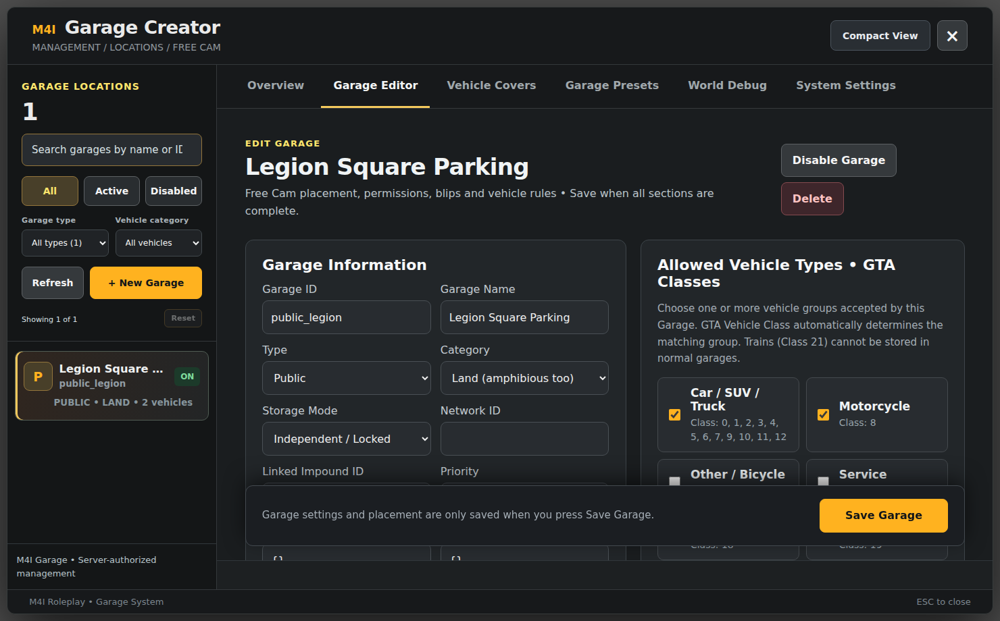

# Configuration — M4I Garage

**Current version:** `0.1.139-alpha` · This page is the short route to the complete, current field-by-field documentation.

## Where do you change Garage behavior?

| Edit location | It controls | How it is saved |
| --- | --- | --- |
| **`m4i_garage/config.lua`** | Interaction keys/radial, distances, fees, Cover item/cooldown, trusted dealer/repair resources, jobs, damage observation | Edit the existing Lua assignment; controlled resource restart |
| **Garage Creator → Garage Editor** | Individual location name, ID, type, storage mode, vehicle class, jobs, 3D zone, spawns, NPC, blip | In-game **Save Garage**, server validation |
| **Garage Creator → Vehicle Covers** | Cover class/model overrides, 3D alignment, object opacity/collision, visible/removable permissions, animations | In-game **Save Cover Rules**, separate from Garage location |
| **Garage Creator → System Settings** | Validated Garage-wide spawn/custody/delivery policy; some displayed limits read-only | In-game authorized Save / SQL |
| **M4I Confige (native M4I)** | Bounded live `StoreDistance`, `TransferBaseFee`, `GpsPurchaseFee`, `DefaultImpoundFee` | Validated GlobalState revision |
| **M4I Bridge config (another resource)** | Framework, actual Inventory/Radial/Target/Phone/Keys/Banking adapters | [Bridge's own guide](../../core/m4i_bridge/complete-provider-setup.md) |

**Complete table of Garage settings, shipped defaults, accepted ranges and effects:** [Every Setting Explained](customization-reference.md).



## Recommended first configuration

```lua
-- Inside m4i_garage/config.lua, edit the existing assignments:
Config.InteractionMode = 'keys'      -- or 'radial' with supported provider
Config.InteractionOpenKey = 'E'
Config.InteractionStoreKey = 'H'
Config.StoreDistance = 3.0
Config.CoverActionCooldownSeconds = 15
Config.DeliveryEnabled = false      -- disable unverified paid AI Valet
```

**These are not all file settings**; use the complete reference for GPS/Insurance/Police/Transfer/Creators/persistence. Never copy a settings key from another store's Garage docs unless it actually exists in this Garage release.

**Next:** [Complete settings](customization-reference.md) · [Installation](installation.md) · [Creator pictures](visual-setup-guide.md) · [Integrations](integrations.md).