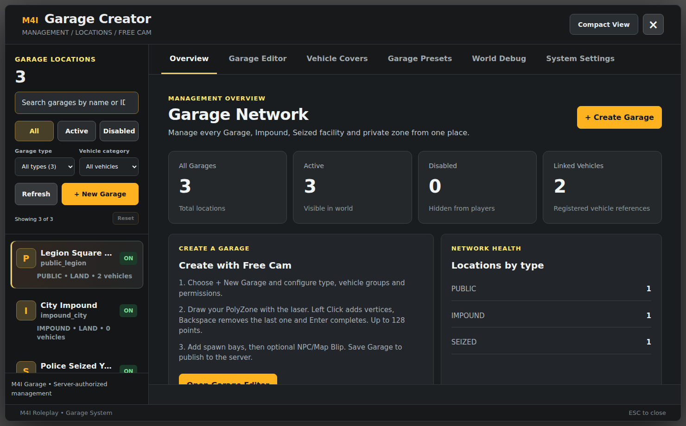

# Installation — From Zero to a Working Garage

This is the **customer installation path for M4I Garage**, from a clean framework to a safe, tested parking location. Follow the steps in order, then select the dedicated framework guide for your actual server.

**Release:** `m4i_garage 0.1.140-alpha`. This document is derived from the resource on the M4I Roleplay test VPS on 7 November 2026. A green startup message is not proof that every optional vendor or gameplay flow works.

## Step 0 — Choose your framework

| Framework actually running | Bridge `Framework` ID | Install guide |
| --- | --- | --- |
| M4I Core | `m4i` | [M4I installation](frameworks/m4i.md) |
| QBCore (`qb-core`) | `qbcore` | [QBCore installation](frameworks/qbcore.md) |
| Qbox / QBX (`qbx_core`) | `qbox` | [Qbox installation](frameworks/qbox.md) |
| ESX Legacy (`es_extended`) | `esx` | [ESX installation](frameworks/esx.md) |
| Ox Core (`ox_core`) | `ox_core` | [Ox Core installation — extra live QA required](frameworks/ox-core.md) |

The exact provider ID matters. **`qbox` is correct; `qbx` is not.** A resource name such as `qb-target` is not the same as Bridge's adapter ID `qb_target`.

## Step 1 — Verify dependencies

**Mandatory:** a healthy single framework, current compatible FXServer with OneSync enabled, `oxmysql`, `m4i_bridge`, and `m4i_garage`. Their resource names must not be changed.

**Select providers, don't duplicate them:** the framework might use `qb-inventory`, `ox_inventory`, `m4i_inventory`, `ox_target`, `qb-target`, `qbx_radialmenu` or `qb-radialmenu`. Only install resources that match your framework and are actually part of your server. Garage gets them through Bridge.

**Optional:** `m4i_upload` for global images, `vehicle_cover` for cover actions, LB/QS phone custom app, external keys, dealer, repair, dispatch, a supported Target if NPC interactions are wanted.

**Never install** `m4i_test_compat`, test-bank data, test player/money helpers or cloned test servers in a customer's production installation.

## Step 2 — Back up before import

Back up (1) the **entire existing database**, especially `player_vehicles` on QB/QBX or `owned_vehicles` on ESX, (2) any old Garage script and its configuration, (3) `server.cfg`, (4) any modified inventory item catalogs, (5) uploaded images and saved Garage state. Prefer a **staging copy of the database** to initial production testing.

**Migration warning:** Existing framework vehicle rows do **not** automatically become M4I Garage-owned vehicles. Native SQL compatibility is a one-way **projection of Garage-owned records** to framework-readable tables, not a magic import of pre-existing cars. Do not stop the old garage without an inventory and compatibility plan. [Details and rollback](updating.md).

## Step 3 — Unzip the actual resource folders

A typical package may contain a distributable wrapper named `m4i_garage [open-source]` or `[escrow]`. **Only the inner folder named exactly `m4i_garage`** goes into the resources directory.

```text
your-server/
  server.cfg
  resources/
    [m4i]/
      m4i_bridge/
        fxmanifest.lua
        config.lua
        adapters/
      m4i_garage/
        fxmanifest.lua
        config.lua
        client/
        server/
        shared/
        sql/install.sql
        web/
        stream/
        docs/
      m4i_upload/          # OPTIONAL; omit if not using shared pictures
```

Do not rename `m4i_garage` or `m4i_bridge`: their cross-resource exports, shared loader and NUI use these names. Do not replace your framework core with a second framework to satisfy the docs.

**Distribution note:** a ZIP called `[escrow]` does not by itself prove Cfx.re Asset Escrow encryption. Verify the protected artifact separately if you need escrowed distribution.

## Step 4 — Prepare the Garage SQL, not your framework's vehicle table

Open `m4i_garage/sql/install.sql`. Import it using your DB administration tool into the **same database that `oxmysql` uses for the running framework**. All statements in the current installer use **`CREATE TABLE IF NOT EXISTS`**; first review the SQL and snapshot your existing data before executing.

The current installer defines these Garage-owned tables:

| Table | What Garage stores |
| --- | --- |
| `m4ig_garages` | Garage ID, zones, spawn bays, type, access, blip/NPC, revision |
| `m4ig_vehicles` | Registered Garage vehicles, owner, plate, condition, legal/physical status |
| `m4ig_cases` | Police Seize/hold cases and release fees |
| `m4ig_audit` | Authenticated action history |
| `m4ig_temp_keys` | Temporary Garage vehicle keys |
| `m4ig_access` | Permanent shared vehicle access |
| `m4ig_identity_map` | Numeric Garage surrogate for external framework character IDs |
| `m4ig_native_vehicle_links` | Optional mapping to native framework vehicle rows |

**Do not drop or rewrite** the existing framework player or vehicle tables. Some optional Garage modules also create **extra support tables on startup**. If runtime DB credentials cannot create tables, a DBA must pre-apply their exact reviewed schemas with a migration account; do not grant unrestricted permanent DDL privileges solely to mask missing installer steps.

**Known optional blocker:** AI Valet's `m4ig_valet_payments` path is not fully covered by the reviewed installer and has native-M4I ledger coupling. Keep `Config.DeliveryEnabled=false` outside a verified compatible setup; see [Known Limitations](../../shared/fivem-install-known-limitations.md).

## Step 5 — Select your actual framework and providers

In **`m4i_bridge/config.lua`**, edit the existing table (do not replace it with a new invented schema):

```lua
M4IBridgeConfig = {
    Framework = 'qbcore',  -- CHANGE to m4i / qbcore / qbox / esx / ox_core
    Inventory = 'framework',
    UI = 'framework',
    Notify = 'framework',
    Progress = 'framework',
    Radial = 'framework',
    Target = 'framework',
    Phone = 'auto',
    Vehicles = 'auto',
    Keys = 'framework',
    Dispatch = 'framework',
    Banking = 'framework',
    Appearance = 'framework',
    Database = 'framework'
}
```

Change **only the `Framework` value** to your actual installed framework as a starting point, then pick explicit adapter IDs where the framework default differs from your installed vendors. A legacy `setr m4i_bridge_profile` line in `server.cfg` may override the Lua framework setting; **search your existing server.cfg before troubleshooting a wrong profile**.

Provider mapping and custom vendor APIs belong to the [M4I Bridge Provider Manual](../../core/m4i_bridge/complete-provider-setup.md). This Garage guide tells you which provider Garage needs; it does **not** duplicate the entire Bridge product documentation.

## Step 6 — Configure Garage interactions and security

Open `m4i_garage/config.lua`. For the **easiest first test on an unknown vendor mix**, use keys mode:

```lua
Config.InteractionMode = 'keys'
Config.InteractionOpenKey = 'E'
Config.InteractionStoreKey = 'H'
Config.InteractionPrompt = true

-- Disable optional paid AI delivery until its full finance/schema
-- integration is positively verified on YOUR framework.
Config.DeliveryEnabled = false
```

These are **existing keys** in the resource, not a full replacement `config.lua`. In keys mode a radial resource is **not required for basic Open/Store**. The chosen Bridge TextUI provider displays the prompt. NPC-specific interactions can still require a Target provider.

If using a verified radial, set `Config.InteractionMode='radial'` and choose the actual registered Bridge radial adapter. If the menu does not appear, don't invent new API names: check [Radial troubleshooting](troubleshooting.md).

For creator/admin access, grant a **trusted group** the exact ACE and ensure your real player is assigned to that group:

```cfg
add_ace group.admin m4i.garage.admin allow
```

The command **`/garagecreator`** opens the editor only for a server-authorized admin. Bridge's `IsAdmin` can also grant access; never open a privileged Creator page to all players.

## Step 7 — Put resources in the right server.cfg order

Do **not** paste all examples at once. Choose **one profile**:

- [M4I native order](frameworks/m4i.md)
- [QBCore order](frameworks/qbcore.md)
- [Qbox/QBX order](frameworks/qbox.md)
- [ESX order](frameworks/esx.md)
- [Ox Core order](frameworks/ox-core.md)

The invariant, regardless of other installed resources:

```text
oxmysql
  → one chosen framework
  → vendor-specific inventory / TextUI / radial / target / keys as required
  → m4i_bridge
  → optional m4i_upload
  → m4i_garage
  → custom addons relying on Garage's exports (where applicable)
```

In an existing server `ensure [qb]` or similar grouped loading, **avoid starting an individual resource twice**. Keep every vendor's declared dependency loaded before the vendor itself.

## Step 8 — Create your first safe test Garage

After FXServer starts:

1. Run **`m4ig_doctor` in FXServer console**, not in player chat. Confirm Bridge, `oxmysql`, framework and relevant selected providers are started, and that Garage is ready.
2. Connect with an authorized admin player. Run **`/garagecreator`**.
3. Choose **+ New Garage**; give a unique ID and human-readable label; type **Public**, category **Land**, storage mode **Independent / Locked**.
4. Select **Car/SUV/Truck** and/or **Motorcycle**, based on the intended vehicle classes.
5. Use Free Cam to place a valid 3D **PolyZone** and at least one clear **spawn bay** with heading. Check Z height, distance from walls, NPCs and other cars.
6. Choose an optional blip and save via **Save Garage**. Refresh the list; verify the saved/active state is returned from the server.
7. **Register an eligible vehicle** through an already integrated trusted dealership server export, or use the admin-only `/garageadopt` workflow for an actual nearby, previously unregistered car in a staging test. Do not insert made-up ownership rows by hand.
8. Stand in the zone near the saved bay. Press **E to Open**, inspect the vehicle, **Retrieve**, then return and press **H to Store** in keys mode.
9. Repeat with a second player, relog, and a server restart in a planned test window; confirm no duplication and persistent fuel/engine/body state.



Full illustrated control walkthrough: [Garage Creator Screenshots](visual-setup-guide.md).

### Optional deletion sync for QB/Qbox/ESX

As of `0.1.140-alpha`, set `DeleteOnNativeRowMissing = true/false` **inside the existing `Config.NativeVehicleCompatibility` table** in `m4i_garage/config.lua`. Default **false** preserves `m4ig_vehicles` when an Admin deletes a native QB/ESX car. **True** requires `Enabled = true`, a previously verified native link and at least 3 minutes of missing-row verification before archiving/deleting **only a safe stored car**.

This is one-way, is not an arbitrary Delete Vehicle export, and must not be enabled before full vehicle SQL backups and framework migration checks. Read the [full safety guide](sql-ownership-and-deletion.md) and restart Garage to apply.

## Step 9 — Turn on optional Garage features one at a time

| Feature | Additional work required | Guide |
| --- | --- | --- |
| Vehicle Cover | Define `vehicle_cover` item and real usable-item hook; select object rules | [Cover setup](vehicle-cover.md) |
| Police Seize / Impound | Create valid facility zones, police jobs/grades, real banking and target where used | [Police & Impound](police-impound.md) |
| Insurance / GPS / Transfer | Validate real personal money provider, locations and available vehicles | [Insurance & GPS](insurance-transfer.md) |
| Dealership sales | Register vehicle through **trusted server export**, correct mapped Garage character ID | [Integrations](integrations.md) |
| External mechanic | Verify paid repair's trusted server permit and durable damage change | [Damage & Repair](damage-persistence.md) |
| Global vehicle images | Optional Upload ID plus Garage UI consumer integration | [Garage image integration](integrations.md#vehicle-images-optional) |
| LB/QS phone | Supported Bridge phone adapter plus actual `phone` inventory item | [Integrations](integrations.md#phone-companion-optional) |
| Old QB/ESX phone/house garage list | Check exact callbacks; optional one-way native SQL compatibility, missing shims as needed | [Legacy migration](updating.md) |

If a third-party script uses **unmatched APIs**, customers may need to edit that script or implement a provider adapter. This is explicitly described in [Required External Edits](integrations.md). The installer does not claim to edit private vendor code automatically.

## Step 10 — Final acceptance / rollback

Do not say “installed successfully” until these pass: no manifest/SQL/provider error, at least one active zone with clear spawns, correct character mapping, vehicle registered/visible, Open/Store/Retrieve successful, condition saved after reconnect, keys & group denied properly, money charged exactly once, Cover/Police only if enabled, and a planned restart with no duplicated vehicles.

**Go-live checklist:** [Verification and acceptance](verification.md) · **Problems:** [Troubleshooting](troubleshooting.md) · **Backups:** [Updating](updating.md).