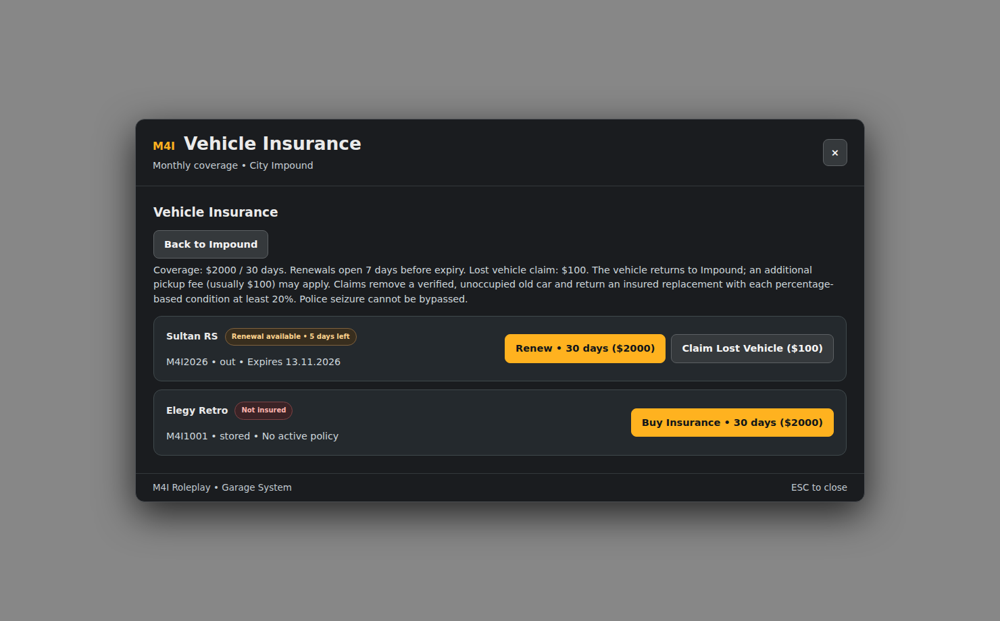

# Insurance, GPS and Garage Transfers

These are **M4I Garage features** controlled by the Garage server and stored vehicle status. They use the selected framework's **personal-money adapter** through Bridge; they do not require installing M4I Finance on every external framework.

**Current Garage:** `0.1.139-alpha`.



*Real NUI interface rendered using illustrative policies/plates. Actual insurance prices, remaining days and eligibility come from your live server.*

## 1. Insurance from the Impound interface

When a player opens a configured **Impound** yard, the services area includes **Vehicle Insurance**. The resulting screen shows each eligible owned car, status (active / renewable / expired / not insured), coverage fee and purchase/renewal actions.

Main settings in `m4i_garage/config.lua`:

| Key | Current default | Purpose |
| --- | --- | --- |
| `InsuranceFee` | `2000` | Cost of one coverage period |
| `InsuranceDurationDays` | `30` | Days of coverage |
| `InsuranceRenewWindowDays` | `7` | Days before expiry when renewal becomes available |
| `InsuranceReminderDays` | `{7,5,3,1}` | Reminder milestones |
| `InsuranceReminderPollMinutes` | `15` | Frequency of checking eligible reminders |
| `InsuranceClaimFee` | `100` | Price of lost-vehicle claim |
| `DefaultImpoundFee` | `100` | Separate normal pickup/recovery fee |

**How to change them:** back up `m4i_garage/config.lua`, edit the existing values and restart Garage during a safe maintenance window. Some supported runtime fees, e.g. `DefaultImpoundFee`, can also be managed through **M4I Confige** in native M4I, and the live value can override the file default.

## 2. Buy and renew coverage

1. Park/register an eligible Garage-owned car and have a working personal bank account.
2. Visit an authorized Impound facility and open **Vehicle Insurance**.
3. Choose **Buy Insurance** on an uninsured car, or **Renew** only in the permitted renewal window.
4. The server verifies player/vehicle ownership, legal status and payment before recording the coverage.
5. Reopen or refresh the screen to confirm the new expiration date, rather than trusting a button animation.

**Important:** an existing legal seizure cannot be bypassed by buying insurance. A failed banking operation must not be reported as successful or partially debit a second time.

## 3. Lost Vehicle Claim

An active policy may allow a **Lost Vehicle Claim** on an eligible currently-out car. The current UI explains the policy before confirming:

- Garage verifies the old car's identity/owner and that it is safe and unoccupied before removing it.
- Server charges the claim fee only through the real validated flow.
- The replacement retains the **same model, plate and insurance**, and returns to **Impound**.
- Fuel, engine, body and tank conditions are floored to **at least 20%** when this claim policy applies; higher old values stay unchanged.
- Existing cosmetic damage can remain; insurance replacement is **not free full bodywork/mesh repair**.
- A **separate pickup fee** may still be required to leave Impound.
- A Police Seized vehicle under legal hold cannot bypass that hold via Claim.

Before enabling claims, test the allowed state transitions with two clients and an occupied/not-occupied old car.

## 4. GPS installation

The Impound services menu contains **GPS Installation** for eligible cars. Its price comes from:

```lua
-- m4i_garage/config.lua
Config.GpsPurchaseFee = 5000
```

The player visits an authorized Impound, views the eligible catalog, and purchases GPS for a car that doesn't already have it. Garage tracks `gps_installed` in its vehicle record. If money is insufficient, the purchase should fail without marking the tracker as installed.

The optional phone companion can use GPS/location actions where supported. This is not an automatic integration with every stock QB/ESX/NPWD phone; use the [Garage Phone Integration Guide](integrations.md#phone-companion-optional).

## 5. Garage-to-Garage transfer

Transfer moves the **stored vehicle's custody record** to another permitted Garage location. It is not a call to spawn the same physical car immediately at the destination.

Player flow:

1. Open the current Garage and locate an eligible stored vehicle.
2. Choose **Transfer** when the action is available.
3. The dialog shows a GTA 2D map, authorized destination pins and a searchable Garage list. Choose a compatible destination for the vehicle's category/type.
4. Review the transfer fee; confirm once.
5. Garage's server verifies ownership/access, destination, legal hold, current custody and payment. On accepted transfer it updates the stored Garage location; the player can retrieve the car **there**.

```lua
-- m4i_garage/config.lua
Config.TransferBaseFee = 500
```

In native M4I, the Confige live-control range is **0–50000** for `TransferBaseFee`. Other fees and transfer variants may apply to certain custody types. Do not change the customer's external bank account via manual SQL to simulate a transfer.

## 6. Optional AI phone delivery is NOT part of normal transfer

The separate AI Valet/Delivery feature has its own `Config.DeliveryEnabled` and associated fees, driver model, radius, timeout and retry controls. The current code's payment recovery path references a `m4ig_valet_payments` table missing from the reviewed base install SQL, and the M4I-specific `m4i_account_ledger` path is not automatically portable across frameworks.

For customer-facing external framework builds:

```lua
Config.DeliveryEnabled = false
```

This keeps normal Garage, GPS, insurance and transfer features available **without advertising an unverified paid valet flow**. See [Known Limitations](../../shared/fivem-install-known-limitations.md).

## 7. Test cases

| Scenario | Expected |
| --- | --- |
| Player insufficient money | No purchase/transfer state change, no partial double debit |
| Car insured with more than 7 days left | Normal active status; renewal policy not yet open |
| Car insured with 5 days left | Renewal action offered and actual new end date shown |
| Claim on seized car | Rejected; cannot bypass legal hold |
| Claim when old car is occupied | Rejected until safe/no occupants |
| Claim succeeded | Replacement in Impound, same plate/model/insurance, preserved eligible condition |
| Transfer to incompatible Air/Water Garage | Rejected |
| Two players transfer same car simultaneously | Only one authoritative state change; no duplication |
| Restart after purchase/transfer | Stored SQL state and insurance/GPS dates persist |

**Related:** [Player Guide](player-guide.md) · [Police & Impound](police-impound.md) · [Configuration](customization-reference.md) · [Troubleshooting](troubleshooting.md).