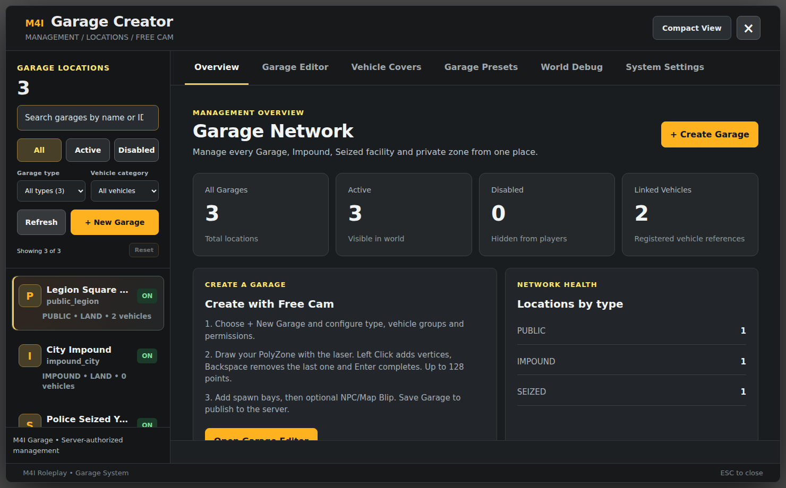

# M4I Garage

**A complete vehicle-custody and garage system for FiveM.** Create parking locations in-game, manage who can use them, store and retrieve registered vehicles, operate Impound and Police Seized yards, protect cars with covers, and retain real vehicle condition across sessions.

**Documented build:** `m4i_garage 0.1.139-alpha` · verified against shipped source on 7 November 2026. **Supported Bridge profiles:** M4I, QBCore, Qbox/QBX, ESX and Ox Core. An Ox Core adapter exists but live five-framework acceptance is **not** yet complete: see the [Ox Core guide](frameworks/ox-core.md).

*Real UI capture from the current resource's HTML/CSS/JS, rendered with illustrative records; not a live player screenshot.*

## Start here

| You want to… | Read |
| --- | --- |
| Install from zero without losing cars | **[Installation — Start to Finish](installation.md)** |
| Pick your own FiveM framework | [M4I](frameworks/m4i.md) · [QBCore](frameworks/qbcore.md) · [Qbox/QBX](frameworks/qbox.md) · [ESX](frameworks/esx.md) · [Ox Core](frameworks/ox-core.md) |
| Create the first Garage with pictures | [Garage Creator — Illustrated Setup](visual-setup-guide.md) |
| See what every configuration field does | [Customization Reference](customization-reference.md) |
| Learn player actions (Open, Store, Retrieve, Keys) | [Player Guide](player-guide.md) |
| Configure Cover objects, permissions and item | [Vehicle Cover Guide](vehicle-cover.md) |
| Configure Police Seize and Impound | [Police and Impound Guide](police-impound.md) |
| Use Insurance, GPS and Transfers | [Insurance, GPS and Transfers](insurance-transfer.md) |
| Retain engine, body, fuel and deformation | [Vehicle Damage and Repairs](damage-persistence.md) |
| Wire Garage into another dealership/phone/keys script | [Garage Integrations](integrations.md) |
| Call the Garage from your own client Lua | [Client Exports](client-exports.md) |
| Call the Garage from trusted server Lua | [Server Exports](server-exports.md) |
| Find admin commands and permissions | [Commands and Permissions](commands.md) |
| Upgrade without losing vehicles | [Updating and Migrating](updating.md) |
| Resolve a startup, UI or SQL error | [Troubleshooting](troubleshooting.md) |

## What this resource actually includes

| Garage capability | How it works |
| --- | --- |
| **Garage Creator** | Admin GUI with Free Cam, polygon zones, spawn bays, categories, access rules, NPCs, custom blips, presets and world debug |
| **Location types** | Public, private, house, apartment, job, business, gang, VIP, fleet, Impound, Seized and Cover allowed/forbidden zones |
| **Land, sea and air** | GTA vehicle-class rules and correct category/vehicle-type validation |
| **Storage** | Independent/locked, shared-network and global public options; server-authoritative vehicle registration |
| **Vehicle condition** | Fuel, engine, body, petrol-tank health, doors, windows, tyres, bumpers and mesh deformation persistence |
| **Keys and access** | Vehicle owner, permanent shared access, temporary keys and security checks |
| **Cover** | Inventory item, 3D objects, allow/deny zones, editable class/model placement, opacity, collision, animations and cooldown |
| **Police and Impound** | Staff-seized custody, reason/officer/fees, authorized release, limited checkout and audit |
| **Insurance, GPS, Transfer** | Coverage/renewal, safe lost-vehicle claim, tracker purchase, transfer between permitted garages |
| **Phone integration** | Optional companion Garage UI in supported phone systems; basic Garage does not require a phone |
| **Developer API** | Read-only client lookups, trusted server reads, dealership registration, keys and repair permits |

**Important scope:** these pages describe **M4I Garage**, not every setting belonging to M4I Bridge, M4I Upload, Finance, Inventory or an unrelated mechanic. When an external script needs a small modification to work with Garage, the [Integrations guide](integrations.md) shows the **exact Garage-side requirement** and links to that product's own manual for its remaining details.

## Required vs optional

**Required for normal Garage:** a running framework, `oxmysql`, `m4i_bridge`, `m4i_garage`, Garage SQL, configured garages and spawn positions.

**Choose one interaction method:** installed compatible radial adapter, **or** `Config.InteractionMode='keys'` with E to Open and H to Store. Target is used by some NPC/police functions.

**Optional:** shared image library, Cover item, supported phone app, native framework SQL projection, GPS/insurance, external dealership/repair bridge, custom vehicle keys. Do **not** install optional scripts you do not use.

**Not automatically handled:** import of pre-existing ESX/QB vehicles, undocumented phone/keys forks, unrelated Garage exports required by a phone/housing script, or native paid AI Valet refunds on all frameworks. Read [Known Limitations](../../shared/fivem-install-known-limitations.md) before enabling such features.

## Support policy

`m4i_garage` is the only authority for Garage vehicles it registers. Never have two Garage controllers spawning the same row. Do not write directly to `m4ig_vehicles` to register a purchase; use the [Server API](server-exports.md). Client-side success does not bypass server authorization.

For installation and feature tests, follow [Go-Live Checklist](verification.md). All screenshots in this documentation show the **actual shipped frontend** with safe sample records; runtime actions still require live FiveM validation.