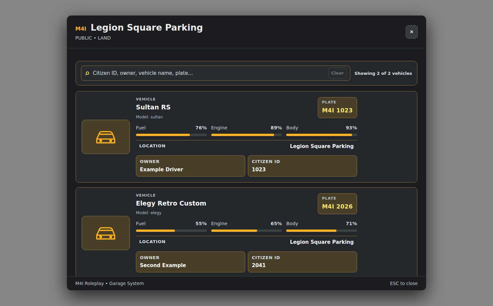

# Player Guide — Open, Store, Retrieve and Share

This page describes what **players actually do in M4I Garage**, not how to configure Bridge or another resource. Admins should first finish [Installation](installation.md) and [Garage Creator](visual-setup-guide.md).

*Screenshot of the shipped NUI with illustrative vehicles. Each customer sees only vehicles allowed by their server and garage state.*

## 1. Open your Garage

1. Go to a Garage marked on the map or found through your server's location list. Some private/role garages hide blips from unauthorized players.
2. Stand **inside the actual 3D PolyZone**, close to a configured **spawn/parking bay**. A visible map marker alone does not guarantee proximity.
3. If the server uses **Radial** mode, open its configured radial menu and choose Garage. The icon and layout depend on the actual installed radial script.
4. If the server uses **Keys** mode, press **E** near the authorized garage bay. The prompt can come from ESX/QB/Ox/M4I TextUI through Bridge.
5. Select an eligible **stored** vehicle and use the available Retrieve/Open action. Garage chooses a safe spawn bay respecting clearance and vehicle category.

**If the Garage menu never appears:** check the correct zone and nearest bay. For administrators, run `m4ig_doctor` and inspect [Troubleshooting](troubleshooting.md). A new Garage with no actual registered cars will correctly show an empty list.

## 2. Understand the vehicle card

| Field | Meaning |
| --- | --- |
| Vehicle Name / Model | Display name and actual registered model |
| Plate | The vehicle's saved plate; not a per-client temporary key |
| Fuel | Last known fuel level (percentage) |
| Engine | Current/persisted engine health shown as a percentage |
| Body | Current/persisted body health shown as a percentage |
| Location | The Garage holding the stored car |
| Owner / Citizen ID | Authorized viewer's available owner details, subject to server access rules |

The search box filters **Citizen ID, owner name, vehicle name or plate**. The script does not automatically register all QB/ESX-owned cars merely because the player has them in their legacy database.

## 3. Store your vehicle

1. Drive **your authorized Garage-owned** car into the location's valid parking area near a supported bay.
2. Come to a stop; the system avoids deleting a car with passengers still aboard. Passengers must exit safely.
3. **Keys mode:** use **H** to Store. **Radial mode:** use its registered Store action.
4. Garage checks the server-owned vehicle identity, actual position, legal hold, category, vehicle access and safe occupant state.
5. On success, Garage saves **fuel, engine, body, petrol tank, doors, windows, tyres, bumpers and deformation** as applicable, and updates custody status. It does not blindly mark every car stored.

If there is no confirmation, do not repeatedly press Store until you've checked the result. Duplicate attempts while a transaction runs must not create a second car.

## 4. Retrieve safely

The retrieved car appears at a clear, valid bay with correct heading and saved condition. The system rejects unsafe positions closer than configured minimum distances to players, vehicles, covers and pedestrians.

**Important:** an already damaged car remains damaged when taken out. A visual repair that did not reach the trusted repair/persistence flow may not clear existing recorded dents, glass, detached parts or tank state. See [Vehicle Damage](damage-persistence.md).

## 5. Owner access, shared keys and temporary keys

- **Owner:** the Garage's registered numeric character ID controls actual ownership.
- **Permanent shared access:** server-authorized shared vehicle permissions; remains tied to Garage's own vehicle records.
- **Temporary key:** issued through Garage's nearby key workflow and validated against player/vehicle proximity; not a transferable “global owner” flag.
- **Vehicle lock:** authorized users can lock/unlock their tracked nearby car via Garage's own key checks, if the interaction is present.
- **External keys resource:** `qb-vehiclekeys` and `qbx_vehiclekeys` have different contracts. If a server uses a fork, its Bridge adapter must match the actual installed export API.

A shared/temporary key does not override Police legal holds or give unrestricted permission to edit Garage locations.

## 6. Other Garage actions

**Transfer:** choose another authorized compatible destination from the Garage transfer dialog and confirm its fee; the list/map is server-authorized. The car is transferred **as custody data**, not teleported across the city. [Transfer details](insurance-transfer.md).

**Impound:** go to the real Impound attendant or matching action and pay applicable fees; GPS and insurance services are available at configured facilities. [Impound guide](police-impound.md).

**Vehicle Covers:** use the optional `vehicle_cover` item near an allowed car/zone; cover visibility, removability and cooldown vary per server. The cover is not ordinary free parking. [Cover guide](vehicle-cover.md).

**Phone companion:** if installed, a supported phone app may list stored cars and provide GPS/location/vehicle actions, but ordinary Garage Open/Store does not depend on any phone app. [Phone integration](integrations.md#phone-companion-optional).

## 7. What the player cannot override

Players cannot change ownership by editing a UI card or Client Exports, directly release a Police Seized case, ignore garage job/grade restrictions, use temporary keys as permanent ownership, or mark an unpaid/full vehicle repair completed. All privileged Garage operations are controlled by **server-side authorization**.

**Administrator reference:** [Garage Creator](visual-setup-guide.md) · [Full Configuration](customization-reference.md) · [Commands](commands.md).