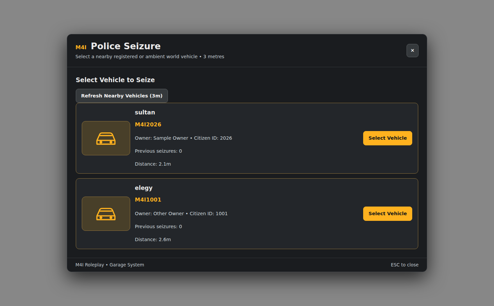

# Police Seized, Impound and Vehicle Recovery

M4I Garage has separate **Impound** and **Police Seized** custody. They are not synonyms: a car with an active legal hold cannot be released merely by paying a normal impound fee.

**Source:** `m4i_garage 0.1.139-alpha`.



*Actual UI screenshot with sample owner names and plates. A real officer's permissions are checked on the server.*

## 1. Create the facilities

In `/garagecreator`, make a **valid location** for each facility used:

1. **Impound:** choose Type **Public Impound**, select Land/Water/Air as appropriate, draw a safe 3D zone, set clear spawn bays and optionally an NPC and visible map blip.
2. **Police Seized:** choose Type **Police Seized**, create a separate valid zone, spawn positions and authorized staff visibility/job rules.
3. Set any **Linked Impound ID** and vehicle categories to actual existing garage IDs, not labels.
4. Save the location and refresh the Creator to confirm the server accepted it.
5. Check players can reach the attendant or eligible police interactions. A hidden yard's blip being invisible to civilians may be expected.

Garage does not automatically transform any arbitrary job/house/gang garage into an Impound. Facility kind and vehicle category have to match the custody workflow.

## 2. Police authorization

Edit `m4i_garage/config.lua`:

```lua
Config.AuthorizedSeizureJobs = {
    police = 0,
    sheriff = 0,
    fib = 0
}

Config.MinimumSeizureReleaseFee = 100
Config.SeizedCheckoutSeconds = 60
```

The table keys are the **exact framework job names**; numeric values are minimum job grades. Do not use visible titles or Discord role labels. The police employee must be loaded and recognized through Bridge. The UI does not authorize a seizure on its own.

## 3. Seize a registered vehicle

1. As an eligible police officer, stand near the eligible unoccupied car (UI searches around **3m**) and open the Police Seize workflow.
2. Use **Refresh Nearby Vehicles (3m)** when the nearby list is stale.
3. Click **Select Vehicle**; verify plate, owner, valid signed vehicle state and target.
4. Choose an actual **Destination Seized Facility**.
5. Enter a meaningful **Seizure Reason**, normally 4–300 characters, and a legal release fee meeting the configured minimum.
6. Confirm. The menu closes/plays the configured police animation; the server checks police grade, vehicle identity and protected state before creating a hold/case.
7. The vehicle remains under **Seized** custody until an authorized server release path changes its legal status.

**Ambient world/unregistered cars** may have a separate **world removal** option. That is not the same as creating a registered owner's Police Seized case; don't promise an owner's impound retrieval for a vehicle that never had a Garage owner record.

## 4. Normal Impound and fees

A normal Impound is a recovery yard with facilities, listed vehicles and optional owner services. Config examples:

```lua
Config.DefaultImpoundFee = 100
Config.GpsPurchaseFee = 5000
```

Use the actual installed **personal banking adapter** and check debit result. A QBCore/ESX/QBX society account is not the player's personal bank balance. Server validation still checks ownership/access and vehicle's true custody state.

Players can access an Impound NPC directly; `/impound` only opens the interaction **when standing near the real attendant**, not from another city.

## 5. Inspect a Seized vehicle

Police are able to inspect case details through the authorized interface, including why it was held and officer/grade context where available. The existing **temporary checkout** has a **60-second** server-owned countdown by default; timeout returns the vehicle to Seized custody unless a legitimate release has been performed.

Do not disable a legal hold by writing a fake client `m4ig_vehicles.physical_status`, deleting a cover, or calling a read-only export.

## 6. Release and condition rules

When an authorized Seized case is released, the vehicle can follow the approved recovery/Impound path. The intended Impound-release safety floor caps **fuel, engine, body and tank condition at not less than 20%** when the applicable release/claim rule says so. It is **not** a full visual restoration and must not blindly clear deformation/windows/doors.

**Police staff jobs, fees and animations are server-controlled.** Garage Creator can also manage validated police emote settings for registered cars, world cars, and checkout. Custom emote definitions are limited/validated; don't insert arbitrary JS, remote URL or executable commands into config.

## 7. Troubleshooting custody

| Issue | Diagnose |
| --- | --- |
| No Police Seize action | Exact job/grade, Bridge identity, valid Target/interaction, NPC/zone and player distance |
| Empty nearby list | Stand within 3m of eligible unoccupied vehicle, refresh; protected/scripted cars may be excluded |
| Destination list empty | Create valid enabled Seized facility with matching vehicle category |
| Fee cannot be paid | Real player account and Bridge banking adapter; don't confuse society with personal |
| Seized car disappears / no case | Server console audit, signed entity, authorized officer and case INSERT result |
| Owner can retrieve a held car | A serious authorization bug: inspect `legal_hold` and custody flow before production |
| Temporary checkout doesn't return | Check real countdown, authoritative server records and resource restart recovery |
| An unregistered car has no owner/Impound row | Ambient world removal is not owner custody |
| Car releases but becomes fully repaired | Check rule: safety condition floor is not a full repair permission |

**Other Garage pages:** [Insurance & GPS](insurance-transfer.md) · [Damage Persistence](damage-persistence.md) · [Commands](commands.md) · [Configuration](customization-reference.md) · [Source Limitations](../../shared/fivem-install-known-limitations.md).