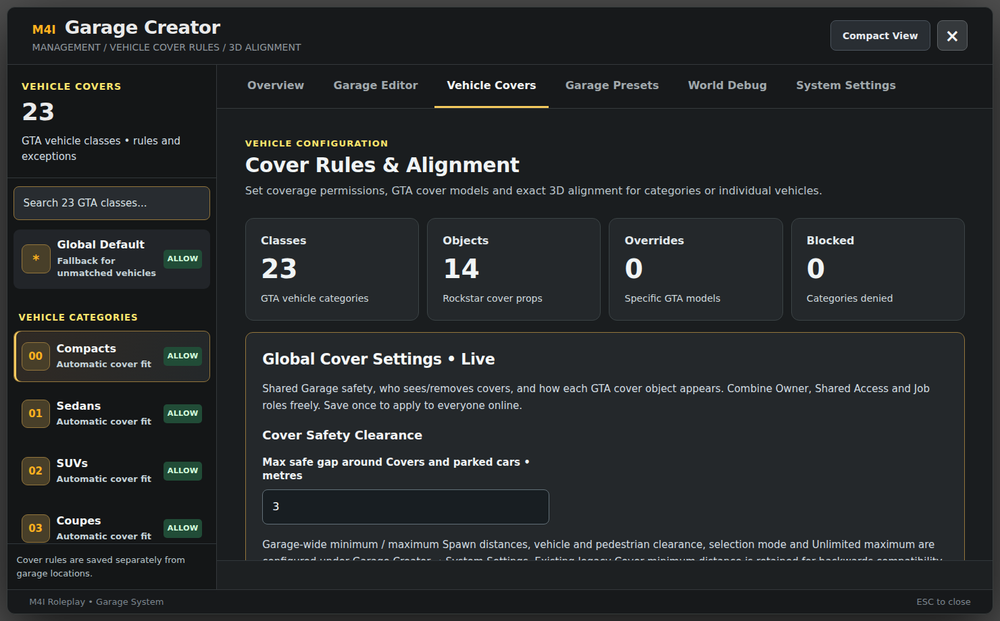

# Vehicle Covers — Installation, Rules and In-Game Use

**M4I Garage `0.1.139-alpha`.** Vehicle Cover is an **optional Garage feature**, not a separate inventory system. It protects an eligible parked, Garage-owned car with a selected 3D cover prop. Visibility/removal policies, model alignment, allowed zones, animations and anti-launch behavior are configured inside Garage Creator.



*Captured from the actual Garage NUI with sample rule data. The real editor loads saved policies from the server before showing the full form.*

## 1. Prerequisites: what do I actually need?

| Component | Required? | Why |
| --- | --- | --- |
| `m4i_garage` + `m4i_bridge` + `oxmysql` | Yes | Vehicle custody, item/identity bridge, persistent cover policy |
| A working inventory provider | **Yes, for item-based Cover** | Hold/verify the exact `vehicle_cover` item |
| `vehicle_cover` item definition | **Yes, if enabling Cover** | Tell your actual inventory the item exists |
| Correct vendor-specific **usable item action** | **Yes, if enabling Cover** | Tell Garage when the player really used that item |
| `m4i_upload` | No | Only for optional image assets, not cover prop rendering |
| Custom cover model assets | Sometimes | Required only if selected props aren't already available in GTA/native streamed models |
| Compatible Garage zone + valid vehicle | Yes | Prevent cover on water, unsafe terrain, denied location or non-registered car |

## 2. Add the item correctly

The intended Garage item key is **`vehicle_cover`** and the configured name in `m4i_garage/config.lua` is:

```lua
Config.VehicleCoverItem = 'vehicle_cover'
```

Do not add `vehicle_cover` to every inventory in your server. **Add it only to the inventory that is actually authoritative**, with a usable callback that reaches Garage's validated Cover action. The current design targets **five successful uses of a physical item**, with usage accounting through a transactional receipt. A vendor integration must support the same semantics; the doctor warns external inventories may need a verified receipt adapter.

- **QBCore + QB Inventory:** item catalog usually `qb-core/shared/items.lua`, plus the installed inventory's usable-item path; do not delete the item on click before Garage confirms.
- **Qbox/QBX + Ox Inventory:** define item in the actual Ox Inventory item data with `consume=0`, then install the required trusted client Use/adapter action. Bridge's Ox server item API alone does not create a client Use hook.
- **ESX:** define the item in the actual ESX/installed inventory table and register its real usable-item event, avoiding double consumption.
- **M4I:** use M4I Inventory's verified item registration and receipt path; still check successful Use + Store/Restore.

**Complete copyable vendor recipes:** [How to Add the Vehicle Cover Item](vehicle-cover-item.md). Do not paste an example from the wrong framework.

## 3. Open the Cover editor

As an authorized admin, run **`/covereditor`** or **`/covermapping`**, or use `/garagecreator` → **Vehicle Covers**.

The screenshot above shows the key areas:

1. **Vehicle classes (23):** choose a GTA vehicle class to allow, inherit or deny Cover. This category is based on actual GTA class, not the friendly displayed model name.
2. **Global Default:** fallback policy for a vehicle that has no more specific rule.
3. **Object selection:** choose an actually available cover prop. The editor presents 14 cover objects in the current frontend; specific streaming assets still need to exist in the customer build.
4. **Exact Vehicle Overrides:** choose an exact **spawn model** (such as `police2`), not the display label, to override its category rule.
5. **3D offsets:** X/Y/Z/heading move and rotate the physical cover relative to the car; validate against actual real vehicles before saving.
6. **Live global options:** visibility, who may uncover, prop alpha, collision, draw distance, animation and timing.
7. **Save Cover Rules:** persist validated settings. **Apply to Existing Covers** is a separate confirmed action; changing defaults doesn't instantly relocate already placed objects.

## 4. Global Cover Settings explained

| Option | What it changes | Why it matters |
| --- | --- | --- |
| Cover Safety Clearance | Safe gap near covers and parked vehicles | Prevent unsafe overlaps before actions |
| Who Can SEE | All players, owner, shared access or exact job/grade | Policy may expose covers to some roles but not others |
| Who Can REMOVE | Owner, shared access, allowed jobs/grade | Separate from visibility; seeing a cover doesn't grant removal |
| Object Opacity | `alpha` 65–255 | Transparent vs solid visual prop |
| Cover Collision | Pass-through or Solid | Solid can block pedestrians; Garage disables dangerous collision before uncover |
| Visibility Distance | 20–125m in editor | Culling/streaming budget |
| Fade In / Fade Out | Validated animation timings | Smooth prop appearance/removal |
| Refresh Interval | 2500–15000ms | How long a distant player may wait for cover visibility |
| Apply/Remove animation | Mechanic, Kneel, Welding, Clipboard or None | Roleplay behavior; test prop and player positions |
| Player Freeze | Boolean | Avoid movement while action is running |
| Auto-disable collision before uncover | Boolean | Critical anti-launch safety for physical props |

The editor has preset buttons such as **FAST**, **REALISTIC**, **IMMERSIVE** and **TEST**, but they stage values in the editor; **Save** is required to persist.

## 5. Where Cover is allowed

Garage Creator can create `cover_allow` and `cover_deny` polygon zones. Denied zones win. With **zero** enabled allowed zones, the default is broadly allowed on suitable dry, stable land, except forbidden zones. The **first enabled allowed zone** changes the allowed-area policy; ensure you understand this before turning it on across a city.

Covers cannot be assumed safe in water, on unstable terrain, in non-permitted zones or on a vehicle that isn't in the correct Garage world/ownership state. Use the Creator's 3D/2D preview to inspect actual physical placement, not just the visible colored 2D area.

## 6. Per-vehicle cooldown and item use

```lua
-- m4i_garage/config.lua
Config.CoverActionCooldownSeconds = 15
Config.CoverUncoverDistance = 3.5
```

The current Garage enforces a **15-second per-vehicle** Cover/Uncover cooldown after successful actions. Valid values for the cooldown are **0–3600 seconds**. Changing these Lua config entries requires an appropriate resource restart.

Intended player flow: acquire `vehicle_cover` → stand near an eligible signed car on safe ground → use the item → see the animation/progress → car becomes covered after server success → later approach near its cover to uncover, with correct permission and cooldown. Do not implement your own `RemoveItem` on client click; leave successful-use accounting to the compatible authoritative receipt path.

## 7. Common cover problems

| Symptom | Check |
| --- | --- |
| Item exists but clicking does nothing | Vendor-specific **client Use** adapter or QBCore/ESX usable callback missing |
| Item disappears immediately / uses incorrect | Inventory auto-consumes or wrong transactional receipt hook |
| UI shows a car icon but no prop | Cover model not streamed or object key/class invalid |
| Cover has wrong height/angle | Model-specific 3D X/Y/Z/heading offset; GTA class mismatch |
| Can't Cover after just uncovering | Per-vehicle **15-second cooldown** |
| Cover disappears outside allowed zone | Check allow/deny polygons, restart recovery policy, stored/physical status |
| Cover launches car | Use Pass-Through or verify collision is disabled *before* prop removal and vehicle spawn; don't force collisions in a custom vendor fork |
| Different viewers see different cover | Server-managed visibility roles/job grades and streaming distance, not merely a client CSS issue |

**Next:** [Item recipes](vehicle-cover-item.md) · [Editor screenshots](visual-setup-guide.md) · [Configuration](customization-reference.md) · [Troubleshooting](troubleshooting.md).