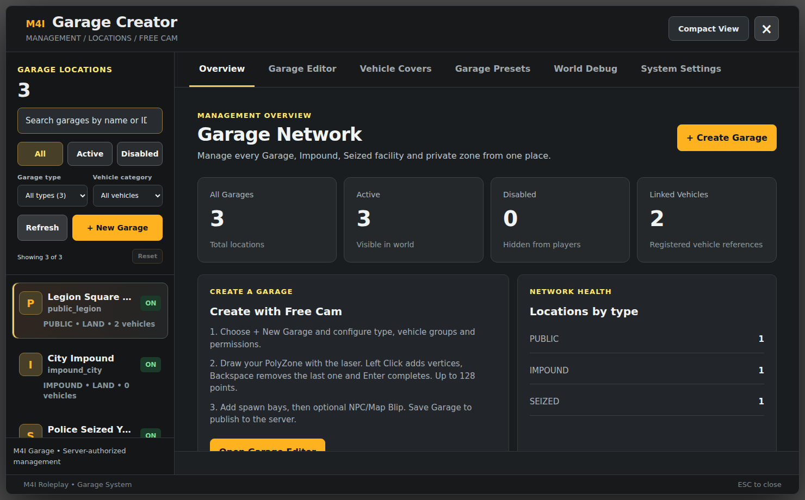
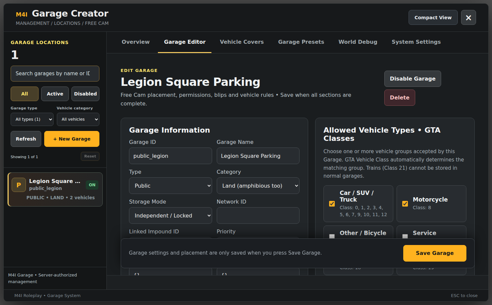
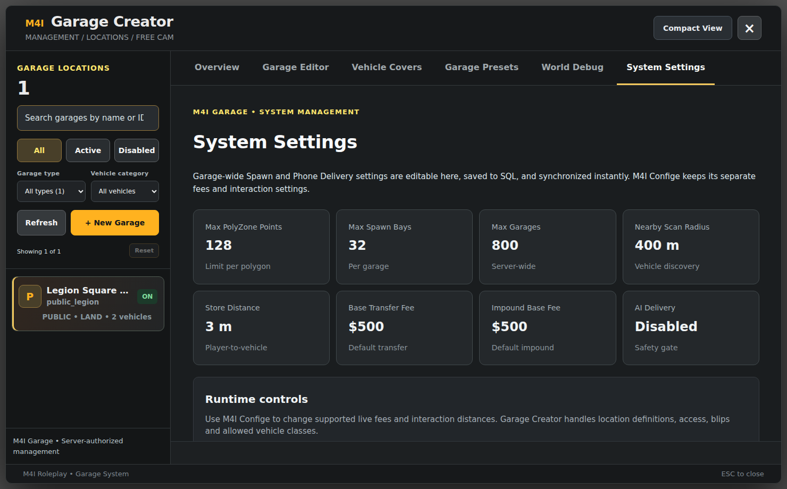
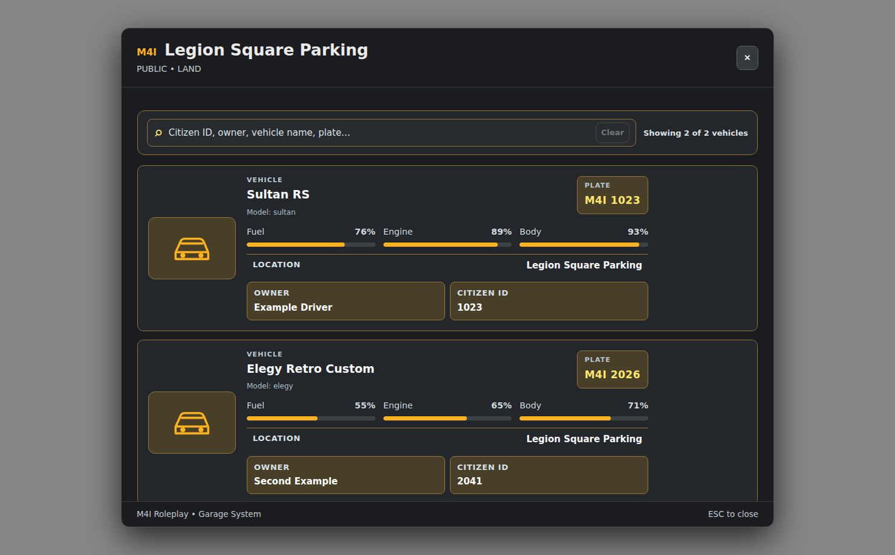

# M4I Garage — Visual Setup and Every Editor Control

**Applies to** M4I Garage `0.1.139-alpha` with M4I Bridge `1.5.19-rc.1`. The images below are **actual screenshots of the shipped Garage NUI frontend**, rendered in a browser with **illustrative sample locations/cars**; they are not screenshots of a live player's session. The buttons, tab labels and layouts come from the real release UI. Values on screenshots are examples and are not guaranteed to match your server.

For installation prerequisites and third-party edits, read [Complete Installation](complete-installation.md) first. This page covers **what each editor option does, how to change it, and where the resulting setting lives**.

## 1 — Open Garage Creator and navigate

The command is **`/garagecreator`** in game. Only a player authorized by `G.admin` / `m4i.garage.admin` may open it. A server console admin can run `m4ig_doctor` to check provider readiness, but that does **not** open the graphical creator.

**What is on this screen**

1. **Garage Locations sidebar:** searchable saved garages; filter All, Active, Disabled, by Garage Type or Vehicle Category. Choosing an existing card loads its editor; `Refresh` asks the server for current data.
2. **Overview:** read-only counts for all locations, enabled/disabled locations and registered vehicle references. A linked vehicle is *not* automatically safe to delete.
3. **+ New Garage / + Create Garage:** begin a new server-side location. Fill name, ID, type, category, vehicle group rules and access before saving.
4. **Garage Editor:** manage a selected garage, its parking positions, PolyZone, map blip, vehicle groups, jobs/groups/citizens and active state.
5. **Vehicle Covers:** independent cover permission and 3D alignment editor. These cover rules are stored **separately** from the garage-location records.
6. **Garage Presets / World Debug / System Settings:** import/reference presets, show debug helpers, inspect/change permitted garage-wide settings.
7. **Compact View:** changes Creator's screen size. The top-right `×` or ESC closes it.

**Safest workflow:** select an empty test garage, make one change, hit the correct Save button, then refresh to verify the server saved it. Do not change a live garage containing cars without checking ownership and location references.

## 2 — Garage Editor fields, classes and safety

Choose **Garage Editor**. The screenshot shows the real field labels and example data:

| Visible field or control | What it does | How to configure safely |
| --- | --- | --- |
| **Garage ID** | Stable location identifier referenced by vehicles, linked impounds and server configs | Choose unique lowercase stable ID, e.g. `public_legion`; never rename an occupied Garage ID casually |
| **Garage Name** | Human-readable title in the UI/map | Enter player-facing text; can be changed without changing its ID |
| **Type** | Public, private, house, apartment, job, business, gang, VIP, fleet, seized, impound, cover-allow or cover-deny | Choose a valid purpose; seized and impound are custody workflows, not ordinary parking |
| **Category** | Land, water or air | Match actual vehicles and garage spawn geometry |
| **Storage Mode** | Independent/Locked, Shared Network or Global Public | Choose based on expected retrieval rules; audit the player's access before using shared/global |
| **Network ID** | Identifier used by participating shared-network garages | Use only when the chosen Storage Mode needs sharing; keep network IDs consistent |
| **Linked Impound ID** | Facility linked to loss/impound workflows | Enter the exact existing Impound Garage ID if that feature is used |
| **Priority** | Ordering for location/conflict selection | Use lower/higher values only according to your actual desired routing; verify overlapping zones |
| **Allowed Jobs JSON** | Minimum grade per allowed job | Example `{"police":0,"mechanic":2}`; exact framework job names, not display labels |
| **Allowed Groups JSON** | Minimum group/role grades | Example `{"gang_example":1}`; require a Bridge provider that returns that group |
| **Allowed Citizens JSON** | Explicit allowed character identifiers | Example `[1001,1002]`; Garage framework-neutral IDs are not always the same as public citizen IDs |
| **Allowed Vehicle Types • GTA Classes** | Car, motorcycle, service, aircraft and other class groups | Select only classes supported by the category; trains (Class 21) cannot use normal Garage custody |
| **Disable Garage** | Disables an empty/eligible location | If the garage has vehicle references, move/release vehicles first; the UI/server refuses destructive shortcuts |
| **Delete** | Permanently removes an empty, disabled location | Disable first, then confirm exact ID; never delete a used custody/impound yard |
| **Save Garage** | Validates and stores the draft on server | Wait for success confirmation, refresh, and inspect the zone in game |

**PolyZone & Free Cam:** use the in-game Creator to place 3D points for the parking zone; left click adds a point, Backspace removes the last point, Enter completes. Add valid spawn bays with correct heading and no obstacles; add an NPC and blip only if needed. Respect real ground height and chosen category. Changes are *not* applied until Save Garage succeeds. The backend's geometry/occupancy checks still apply when you create a garage.

**NPC / Target:** when a garage uses NPC interactions, the configured Bridge `Target` must have a working entity add/remove adapter. For ordinary Open/Store a radial is optional: `Config.InteractionMode='keys'` gives E Open and H Store inside valid zones.

## 3 — Garage System Settings versus Confige versus config.lua

Choose **System Settings**:

The screen combines **read-only capacity/current values** and **runtime policy controls**. It does **not** imply every value is editable on this screen. Its own text directs customers to **M4I Confige** for supported live fees/distances and to Garage Creator for location-specific settings.

- **Max PolyZone Points, Max Spawn Bays, Max Garages:** limits and/or current policy; the number shown in the example screenshot is a frontend preview, not a substitute for the installed `Config.MaxPolygonPoints` and `Config.MaxSpawns` values.
- **Nearby Scan Radius and Store Distance:** how far the resource searches for nearby entities / permits Store; gameplay and performance affect suitable values.
- **Base Transfer Fee, Impound Base Fee:** amounts charged by the trusted server flow; do not edit invoice or bank SQL directly.
- **AI Delivery:** optional. **Keep disabled on external-framework deployments until the known Valet payment schema and framework-neutral recovery logic are fixed and verified**, documented in [Known Limitations](../../shared/fivem-install-known-limitations.md).
- **Runtime controls:** some settings are persisted live in Garage SQL while other values are in `m4i_garage/config.lua` and need a safe resource restart. Never assume a screen display is permission to change arbitrary server config.

**Where to edit which setting:** [Complete Customization Reference](customization-reference.md).

## 4 — The player-facing Garage list

After a valid player interacts with a Garage, the UI shows only authorized relevant vehicles:

The search accepts vehicle name, plate, owner or citizen ID. Each vehicle card shows **model, plate, fuel, engine, body, location and owner** when allowed. **These are illustrative entries**, not real live-player details.

- **No cars listed:** first check that cars are actually registered in Garage's `m4ig_vehicles`, in the right location and status, and that the player has the mapped framework identity/permission. Merely owning a `player_vehicles` / `owned_vehicles` record does not mean Garage has imported it.
- **Cannot Store:** confirm player's vehicle is eligible, completely within allowed zone, has correct category, is not seized, and any passengers exit safely. Check server and F8 feedback rather than repeatedly pressing Store.
- **Image appears as an icon:** the example screenshot falls back to built-in GTA symbol; custom images require `m4i_upload` and a correct consumer mapping, or the vendor's original expected local image.
- **Engine/Body values:** these are Garage's retained vehicle-condition readings; valid repairs must be committed by the mechanic/repair integration to prevent old damage returning.

## 5 — Vehicle Covers and customization

Open **Vehicle Covers** to configure **GTA vehicle class rules**, optional model-specific overrides, global visibility/permissions, 3D cover alignment, animations and collision/opacity where supported by the current build. The editor loads real saved values **asynchronously** from the server. Do not document its temporary “Loading categories...” state as a completed settings screen.

Main concepts:

- **Allowed/Forbidden zones:** `cover_allow` and `cover_deny` are special Garage Creator zone types. Denied zones take priority. If **zero** enabled allowed zones exist, dry safe land is generally allowed unless explicitly denied.
- **Who can see/remove:** owner, shared vehicle access and configured job/grade rules. Being able to see a prop is separate from permission to uncover it.
- **Cover 3D model and offsets:** choose an actual streamed GTA model/texture or a safe built-in fallback; check clipping/collision before publishing.
- **Animations & fade/duration:** the Cover editor's global appearance group includes apply/remove animations, player freeze and fade timings. Do not allow cover collision removal to launch vehicles.
- **Cooldown:** `Config.CoverActionCooldownSeconds` is a **server-enforced per-vehicle** cooldown after successful Cover/Uncover. Default **15 seconds**; changing it in code requires a resource restart.
- **Cover item:** `vehicle_cover` provides five successful uses per physical item and is optional for normal Garage storage. See [Item Setup, with Ox client adapter](vehicle-cover-item.md).

## 6 — Screenshots are not installation proof

Each image is from the actual delivered HTML/CSS/JS NUI version, **captured outside FiveM with synthetic example data**. It demonstrates the controls and flow, not successful server-side permissions, database writes, actual GTA vehicle physics, or customer-specific addons. Confirm the real interactions and saved values in a live FiveM session.

Next: [Full Installer](complete-installation.md), [Configuration Reference](customization-reference.md), [Garage Vehicle Damage and Repairs](damage-persistence.md), [Bridge Providers](../../core/m4i_bridge/complete-provider-setup.md), [Final Acceptance QA](../../shared/fivem-qa-checklist.md).

### More Garage feature screenshots

- [Vehicle Cover Rules, loaded and editable](vehicle-cover.md) — real NUI screenshot with sample rules
- [Police Seizure](police-impound.md) — actual officer's Seize form and custody explanation
- [Insurance, GPS and Transfer](insurance-transfer.md) — actual Garage Insurance interface
- [Player's vehicle list](player-guide.md) — search, conditions, ownership and Store/Retrieve
