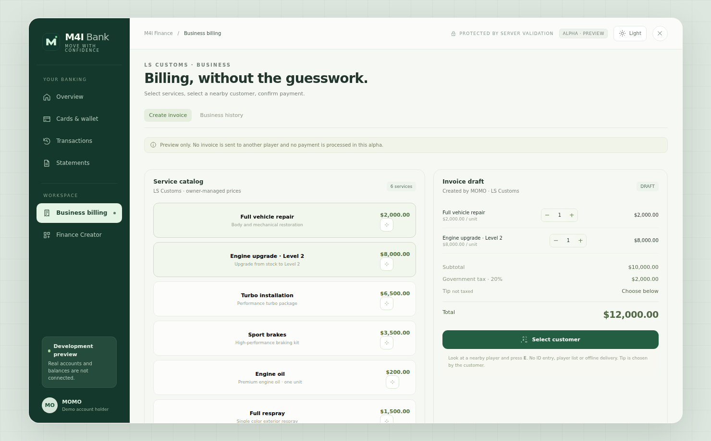

# Mechanic → Finance → Garage: Illustrated Integration and Settings

This guide describes how an owner connects **M4I Mechanic `0.1.6-alpha`** to **M4I Finance** and **M4I Garage `0.1.139-alpha`**, and which parts a customer may safely configure. The mechanic *fulfilment resource does not ship its own NUI HTML*. The mechanic service-selection/invoice interface is displayed by **M4I Finance**, so that is the real UI shown below.

**Important compatibility note:** the shipped `m4i_mechanic` directly calls `exports.m4i_core:GetCharacterId` and only permits calls from the resource **`m4i_finance`**. This implementation is native-M4I-specific. **Do not advertise it as plug-and-play on QBCore, ESX, Qbox or Ox Core** without a tested character-identity and invoice-service adapter.

## 1. The actual invoice interface



*Real M4I Finance frontend, captured in its built-in **development preview**. Prices, staff name, sample vehicle services, tax and balances are demonstration data; **the screenshot itself says no real payment is processed**. A live customer's catalog/prices can differ.*

How a mechanic uses this interface:

1. Open the **Business billing** section of M4I Finance, with a valid active business/employee role and allowed invoicing permissions.
2. In **Service catalog**, choose vehicle service(s). The current example UI shows repair, engine upgrade, turbo, brakes, oil and respray, but **only service keys accepted by the authoritative server `m4i_mechanic` catalog are eligible for mechanic fulfilment**. UI demo text is not proof that all shown options are implemented by the backend.
3. Review **Invoice draft**. Quantities, subtotal, tax and total must match the business' actual server-sourced service catalog. Don't copy demo money values to production.
4. Choose **Select customer** and target a real nearby player/vehicle. Server checks max customer distance, vehicle network ID, model, plate and permitted vehicle class.
5. When a **real payment confirmation** is accepted server-side through Finance, only then call Mechanic's trusted invoice-fulfilment server export. The client receives a limited paid service request and reports exactly which approved lines were applied.
6. For a paid **full repair** of a Garage-signed vehicle, Mechanic requests Garage's trusted `AuthorizeFullRepair` permit before applying natives. Garage then commits full repair / deformation state through its own authority. Without that permit, a signed vehicle's paid repair must be rejected rather than visually repairing the vehicle while SQL retains its old damage.

**Do not use client-only `SetVehicleFixed` calls as proof of paid service or durable Garage repair.** Keep payment, ownership, invoice and audit server-side.

## 2. Native M4I start order and mandatory dependencies

The current Mechanic resource requires:

- `oxmysql` started first; Mechanic's `server/db.lua` creates `m4i_mechanic_vehicle_state` and `m4i_mechanic_fulfillments` at startup.
- `m4i_core` to resolve a numeric character ID using `GetCharacterId`.
- `m4i_finance` for the **only authorized server caller** of invoice/vehicle resolution exports.
- `m4i_mechanic` for paid fulfilment, vehicle target validation, engine upgrades and server state.
- `m4i_garage` plus `m4i_bridge` if repair must persist on Garage-owned cars; Garage validates its own security.

A recommended native-M4I startup segment **inside an existing valid server.cfg** is:

```cfg
ensure oxmysql
ensure m4i_core
ensure m4i_bridge
ensure m4i_garage
ensure m4i_mechanic
ensure m4i_finance
```

**This is a dependency-oriented example**, not a replacement `server.cfg`: retain your real other M4I dependencies in their proper order. Verify that the two resources expose and call the correct invoice integration. Never delete existing Garage vehicle state or let an untrusted client invoke a paid service export.

## 3. Exactly what customers can change in Mechanic

Open `m4i_mechanic/config.lua` and adjust entries **inside** the already existing `M4IMechanicConfig` table. Do not overwrite it with the examples below.

| Real setting | Shipped value | Purpose / accepted values |
| --- | --- | --- |
| `TargetDistance` | `6.0` | Maximum customer-to-vehicle distance for mechanic-targeted invoice. Valid **2–16 metres** in Confige's live validation |
| `InvoicePairDistance` | `7.0` | Maximum distance between the mechanic issuing the invoice and the customer. Valid **2–16 metres** |
| `ControlTimeoutMs` | `2000` | How long the vehicle client can request network control for an authorized service. Valid **500–8000 ms**, integer |
| `StatePollMs` | `1500` | Interval to detect a changed/current driver vehicle and request persisted engine tuning. Valid **750–10000 ms**, integer |
| `MechanicJobs` | `mechanic,mechanic2,mechanic3,bennys,beeker` | Allowed exact framework job names; use a server-trusted allowlist, not UI labels |
| `Services` | `inspection,repair,oil_change,tyres,engine_1..engine_4` | Server-accepted service identifiers; changing them does **not automatically add** an item to the Finance business catalog |
| `DisallowedVehicleClasses` | `13,14,15,16,21` | GTA classes not eligible for paid vehicle modifications; check real model/class before allowing |

**Which settings are live?** Confige's `m4i_mechanic_live_settings` currently supports the first four distance/time values (with validation/revisioning). The job allowlist, service list and disallowed classes are protected and **not** openly editable through the live settings payload. Editing their file definitions requires a controlled restart and server compatibility test.

### Example A: let the mechanic work farther away

```lua
M4IMechanicConfig.TargetDistance = 8.0
M4IMechanicConfig.InvoicePairDistance = 9.0
```

This is **illustrative post-table assignment syntax**; edit the existing table fields instead of appending duplicate declarations. A larger radius can select an unintended vehicle, so keep the smallest realistic values for your map.

### Example B: add a trusted job

Within the existing `MechanicJobs` table:

```lua
MechanicJobs = {
    mechanic=true,
    mechanic2=true,
    mechanic3=true,
    bennys=true,
    beeker=true,
    custom_mechanic=true
},
```

Only grant this job if your framework really uses **`custom_mechanic`** and Finance assigns that job to authorized employees. An arbitrary group name or Discord role does not automatically become a framework job.

### Example C: change the service catalog

Within `Services`, accept only real implemented service keys. For the shipped code, key behaviours include:

| Service | Mechanic's actual implementation |
| --- | --- |
| `inspection` | Backend fulfillment entry marks applied; no `SetVehicleFixed` client transformation |
| `repair` | Paid full repair; GTA body/engine/tank + Garage-authorized deformation/door/window persistence |
| `oil_change` | Durable service timestamp in Mechanic DB |
| `tyres` | Repair tyre indices via GTA natives |
| `engine_1` to `engine_4` | GTA engine mod 11 or a capped power multiplier fallback if that model lacks mod slot |

**Do not advertise demo-only catalog services like `turbo`, `brakes` or `respray` as implemented Mechanic service handlers unless you add and verify their server/client logic.** The Finance demo screenshot can display them, but that does not activate GTA functions.

### Example D: change Garage's trusted repair permissions

In `m4i_garage/config.lua`, keep the existing entries and allow the exact known Mechanic server resource name:

```lua
Config.RepairTrustedResources = {
    m4i_mechanic = true,
    m4i_admin_next = true
}
```

This list is **not a player permission** and not a list of any mechanic job; it controls which **server resources** may authorize a full repair. The mechanic's own invoice validation still applies. If using another paid mechanic vendor, integrate its server-side successful-repair event with Garage's permit API and list **only that exact trusted resource**. Use [Garage Config Reference](../m4i_garage/customization-reference.md).

## 4. What's required when a server uses a different framework?

Native `m4i_mechanic` currently binds character lookup to `m4i_core` and invoice authorization to `m4i_finance`. For QBCore/ESX/Qbox/Ox Core:

1. Supply a tested framework-neutral identity adapter for the **mechanic customer character**, not just the Garage player's identity.
2. Implement an authenticated payment/invoice lifecycle mapping, preserving service line IDs, amount, statuses and idempotency.
3. Integrate the actual mechanic UI of the **third-party** vendor if not using M4I Finance. Its screenshot and controls will **not** look like the M4I Finance example.
4. Apply full repairs through Garage's server permit/reconciliation flow, and test tyre/engine/body/tank/deformation after vehicle Store → Retrieve.
5. Use two real clients, engine damage and a full repair paid once; test cancellation, network-control failure, duplicate invoice, reconnect, server restart and non-owner attempts.

Until those integrations are built and validated, the Garage can still use ordinary Open/Store and an independent mechanic, but **do not claim native M4I Mechanic/Finance billing is ready for an external framework**.

## 5. Screenshot and testing checklist

- [ ] Mechanic can open Business Billing **only with real staff permission**.
- [ ] Real catalog has only server-supported service identifiers and actual prices.
- [ ] Nearby customer + car validation succeeds; a too-far or forbidden class is rejected.
- [ ] A paid Invoice is confirmed once, and every service line is recorded as applied or pending.
- [ ] A Garage-signed vehicle's full repair persists after storing and taking back the vehicle.
- [ ] Partial repair does **not** reset all old damage or regenerate broken body parts.
- [ ] Players cannot trigger client/server paid services without Finance's valid invoice.
- [ ] Customers of QB/ESX/Qbox are told the truth: this M4I-native invoicing integration needs an adapter.

**Related:** [Garage Visual Guide](../m4i_garage/visual-setup-guide.md), [Complete Garage Installer](../m4i_garage/installation.md), [Garage Config Reference](customization-reference.md), [Known Limitations](../../shared/fivem-install-known-limitations.md).