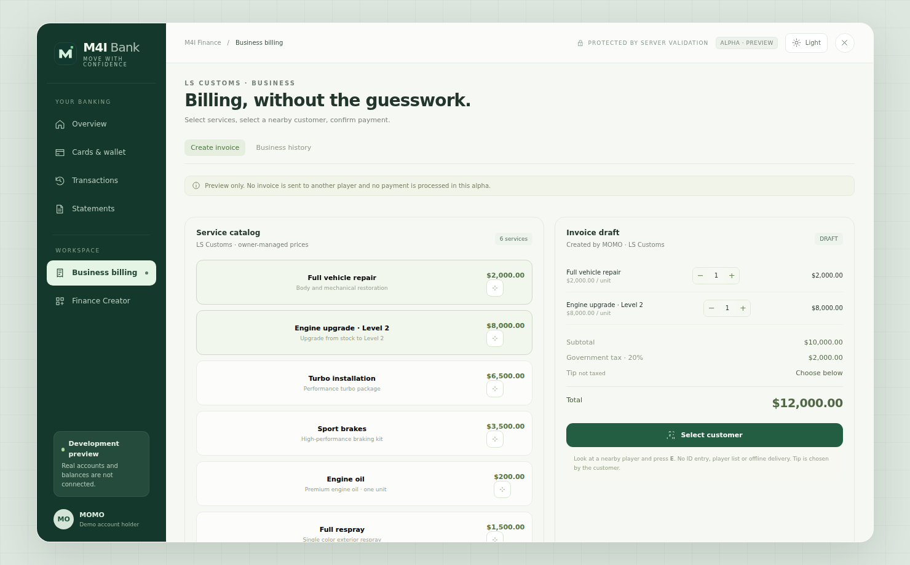

# m4i_mechanic

> **ILLUSTRATED MECHANIC GUIDE:** [Mechanic settings and real Finance billing UI screenshot](finance-integration.md). The source `m4i_mechanic` is a backend fulfilment script, not a separate mechanic NUI. The example screenshot belongs to `m4i_finance` **development preview**. Includes exact configuration keys, allowed jobs, service availability, Garage repair persistence and framework compatibility cautions.

**Source inventory:** rechecked against the Roleplay VPS's installed Mechanic resource on 2026-11-07. This is a source inspection, not a completed end-to-end paid gameplay test.

**Manifest description:** M4I Mechanic — paid service fulfillment and persistent engine state

**Installed manifest version:** 0.1.6-alpha (7 Nov 2026)

**M4I dependencies explicitly declared:** No explicit M4I dependency detected in the manifest (does not prove zero runtime dependencies)

**GitHub source:** [m4i-store/m4i_mechanic](https://github.com/m4i-store/m4i_mechanic)

## Source authority

The VPS copy at resources/[m4i]/m4i_mechanic was treated as the most current candidate. Compare the working tree against the GitHub branch and resolve modifications before merging; do not overwrite VPS files with an older checkout.

## Integration and configuration

The shipped Mechanic code currently calls `m4i_core` for character identity and accepts trusted invoice calls from `m4i_finance`. It uses `m4i_garage:AuthorizeFullRepair` for signed cars and `oxmysql` for persistence. **It is native-M4I-specific without an external-framework adapter.** Confige validates four runtime settings; jobs, service allowlists and vehicle class filters remain file/server controlled. [Read the full illustrated source-derived setup and field-by-field explanation](finance-integration.md).

## Documentation status

The linked illustrated guide now covers current configuration keys, trusted invoice exports, Garage repair permits, built-in schema creation and the M4I Finance preview screen. **Live payment, full repair after Store/Retrieve and external-framework support still require in-game QA.**

## 2026-10-23 Confige Live Settings

Source at https://github.com/m4i-store/m4i_mechanic main commit 402fb5c is based on the latest Roleplay VPS Mechanic implementation with no live database files. A shared client/server live adapter accepts four bounded, schema-verified settings from M4I Confige: target and invoice-pair distance, vehicle network-control timeout and vehicle-state polling frequency. The original server-side invoice, character, job and finance checks remain intact. This paragraph records the older 0.1.5-alpha source milestone; installed source reviewed on 7 Nov 2026 reports 0.1.6-alpha. Live Save & Apply and paid-service acceptance still require QA.
